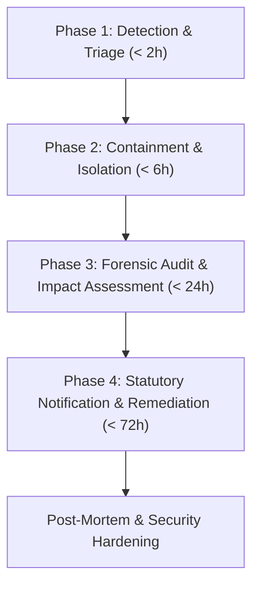

# India DPDP Act 2023 & IT Act 2000 Compliance Architecture

> **LEGAL NOTICE & STATUTORY DISCLAIMER**  
> This documentation and the accompanying codebase constitute a technical compliance architecture designed to align with India's **Digital Personal Data Protection Act, 2023 (DPDP Act 2023)**, the **Information Technology Act, 2000 (IT Act 2000)**, the **IT (Reasonable Security Practices and Procedures and Sensitive Personal Data or Information) Rules, 2011 (SPDI Rules)**, and the **Real Estate (Regulation and Development) Act, 2016 (Karnataka RERA Rules 2017)**.  
> All policy documents, consent disclosures, and grievance procedures in this project are baseline technical implementations and drafts. They **must be formally reviewed and approved by an advocate enrolled with the Bar Council of India** specializing in Indian privacy and real estate law prior to public commercial deployment.

---

## 1. Compliance Architecture Overview

| Regulation | Scope in Project | Technical Enforcement |
| :--- | :--- | :--- |
| **DPDP Act, 2023** (§ 5, 6, 7) | Notice, Specific Consent, Purpose Limitation | Multi-lingual unbundled checkboxes, cryptographic consent logs, zero pre-ticked inputs |
| **DPDP Act, 2023** (§ 8(5), (7), (8)) | Reasonable Security, Erasure, Purpose Cessation | AES-256-GCM encryption at rest, salted SHA-256 IP hashing, 12-month automated inactivity anonymization |
| **DPDP Act, 2023** (§ 8(6)) | Personal Data Breach Notification | 72-hour Data Protection Board of India (DPBI) incident response protocol & logging |
| **DPDP Act, 2023** (§ 9) | Processing Children's Personal Data | 18+ strict threshold declaration, zero tracking of minors, no targeted behavioral profiling |
| **DPDP Act, 2023** (§ 11, 12, 13) | Right to Access, Correction, Erasure, Grievance | Self-service DSR portal with unique tracking ID and 30-day statutory SLA countdown |
| **IT Act, 2000 & SPDI Rules** | Reasonable Security (§ 43A, § 72A) | Strict HSTS, CSP, rate limiting, Cloudflare Turnstile, TOTP 2FA, immutable audit log |
| **Karnataka RERA Rules 2017** | Mandatory Advertisement Disclosure (§ 11(2)) | Karnataka RERA registration number enforced on all listing cards, modals, and footer |
| **TRAI TCCCPR 2018** | Commercial Communications & DND Rules | Explicit opt-in modal prior to WhatsApp / telephony contact with unsubscribe link |

---

## 2. Requirement-to-Code Mapping Matrix

### Rule 1: Consent Architecture (DPDP Act § 6)
*Requirement: Unbundled, explicit consent in plain language (with Kannada/Hindi toggles). No pre-ticked checkboxes. Verifiable audit log with timestamp, IP hash, and consent version. Easy withdrawal.*

| Feature | Implementation Details | Source Files |
| :--- | :--- | :--- |
| **Cookie Banner** | 3-tier choice: *Accept All*, *Reject Non-Essential*, *Customize*. Blocks analytics/marketing cookies until user explicitly consents. Persistent settings button in footer. | [`src/components/CookieBanner.tsx`](file:///d:/Urdigix_Projects/NRN_PROPERTIES_WEBSITE/src/components/CookieBanner.tsx) [`src/lib/cookie-consent.ts`](file:///d:/Urdigix_Projects/NRN_PROPERTIES_WEBSITE/src/lib/cookie-consent.ts) [`src/components/CookieSettingsButton.tsx`](file:///d:/Urdigix_Projects/NRN_PROPERTIES_WEBSITE/src/components/CookieSettingsButton.tsx) |
| **Form Consent Box** | Separate, mandatory, unchecked checkbox. Multi-language toggle (**English**, **ಕನ್ನಡ - Kannada**, **हिन्दी - Hindi**). States exact purpose, data collected, and contacting parties. | [`src/components/ConsentNoticeBox.tsx`](file:///d:/Urdigix_Projects/NRN_PROPERTIES_WEBSITE/src/components/ConsentNoticeBox.tsx) [`src/lib/consent-notices.ts`](file:///d:/Urdigix_Projects/NRN_PROPERTIES_WEBSITE/src/lib/consent-notices.ts) |
| **WhatsApp Explicit Opt-in** | Direct WhatsApp redirects blocked until user completes modal consent acknowledging TRAI DND rules and property-specific communication. | [`src/components/WhatsAppChatModal.tsx`](file:///d:/Urdigix_Projects/NRN_PROPERTIES_WEBSITE/src/components/WhatsAppChatModal.tsx) |
| **Cryptographic Consent Logging** | Captures `purpose`, `consentVersion` (`v1.0-2026-03`), salted SHA-256 IP hash, user agent, URL, and timestamp in Prisma `ConsentLog`. | [`src/app/api/leads/route.ts`](file:///d:/Urdigix_Projects/NRN_PROPERTIES_WEBSITE/src/app/api/leads/route.ts) [`src/app/api/consent/cookies/route.ts`](file:///d:/Urdigix_Projects/NRN_PROPERTIES_WEBSITE/src/app/api/consent/cookies/route.ts) [`prisma/schema.prisma`](file:///d:/Urdigix_Projects/NRN_PROPERTIES_WEBSITE/prisma/schema.prisma#L46-L59) |
| **Consent Withdrawal** | Dedicated self-service option in DSR portal immediately sets consent status to `REVOKED` and triggers anonymization pipeline. | [`src/app/user-rights/page.tsx`](file:///d:/Urdigix_Projects/NRN_PROPERTIES_WEBSITE/src/app/user-rights/page.tsx) [`src/app/api/user-rights/route.ts`](file:///d:/Urdigix_Projects/NRN_PROPERTIES_WEBSITE/src/app/api/user-rights/route.ts#L67-L95) |

---

### Rule 2: Data Minimisation & Purpose Limitation (DPDP Act § 6(1), § 7)
*Requirement: Collect strictly necessary fields (name, phone, optional email, locality/budget, message). Zero collection of Aadhaar, PAN, banking, or credit card details. Use lead data solely for the requested enquiry.*

| Feature | Implementation Details | Source Files |
| :--- | :--- | :--- |
| **Strict Form Schema** | Zod schema rejects unexpected parameters. Only accepts: `name`, `phone` (10-digit Indian standard), `email` (optional), `locality`, `budget`, `message`, `propertySlug`. | [`src/app/api/leads/route.ts`](file:///d:/Urdigix_Projects/NRN_PROPERTIES_WEBSITE/src/app/api/leads/route.ts#L22-L35) |
| **Zero Sensitive Identity Storage** | Database schema contains no columns or structures for Aadhaar, PAN, voter ID, passports, UPI IDs, or credit/debit cards. | [`prisma/schema.prisma`](file:///d:/Urdigix_Projects/NRN_PROPERTIES_WEBSITE/prisma/schema.prisma#L27-L44) |
| **Purpose Limitation Lock** | Every lead record binds explicitly to `propertyTitle` and `propertySlug`. Privacy Policy prohibits secondary marketing, cross-selling, or unauthorized list transfers. | [`src/app/privacy/page.tsx`](file:///d:/Urdigix_Projects/NRN_PROPERTIES_WEBSITE/src/app/privacy/page.tsx#L55-L75) [`src/components/EnquiryForm.tsx`](file:///d:/Urdigix_Projects/NRN_PROPERTIES_WEBSITE/src/components/EnquiryForm.tsx) |

---

### Rule 3: Notice, Transparency & Grievance Redressal (DPDP Act § 5, § 13; IT Act § 79)
*Requirement: Accessible Privacy Policy with purpose, retention, third-party sharing list, user rights, and designated Grievance Officer responding within 7 calendar days.*

| Feature | Implementation Details | Source Files |
| :--- | :--- | :--- |
| **Comprehensive Privacy Policy** | Draft policy covers statutory notice requirements, legal basis, data sharing partners, security practices, and 12-month retention schedule. | [`src/app/privacy/page.tsx`](file:///d:/Urdigix_Projects/NRN_PROPERTIES_WEBSITE/src/app/privacy/page.tsx) |
| **Statutory Grievance Redressal** | Outlines 3-tier escalation framework (Tier 1: Grievance Officer, Tier 2: Internal Appellate Board, Tier 3: DPBI). Explicit 7-day resolution SLA. | [`src/app/grievance/page.tsx`](file:///d:/Urdigix_Projects/NRN_PROPERTIES_WEBSITE/src/app/grievance/page.tsx) |
| **Grievance Officer Information** | Contact card with designated officer name, email (`grievance@[BUSINESS_DOMAIN]`), physical address in Bengaluru, and working hours. | [`src/app/contact/page.tsx`](file:///d:/Urdigix_Projects/NRN_PROPERTIES_WEBSITE/src/app/contact/page.tsx#L110-L138) [`src/components/Footer.tsx`](file:///d:/Urdigix_Projects/NRN_PROPERTIES_WEBSITE/src/components/Footer.tsx) |
| **Terms & Conditions** | Governed under Information Technology Act 2000, Indian Contract Act 1872, and Bengaluru court jurisdiction. | [`src/app/terms/page.tsx`](file:///d:/Urdigix_Projects/NRN_PROPERTIES_WEBSITE/src/app/terms/page.tsx) |
| **Cookie & Tracking Policy** | Itemized table of essential vs non-essential cookies, lifetime, and data governance. | [`src/app/cookies/page.tsx`](file:///d:/Urdigix_Projects/NRN_PROPERTIES_WEBSITE/src/app/cookies/page.tsx) |

---

### Rule 4: Data Subject Rights / DSR Portal (DPDP Act §§ 11–14)
*Requirement: Self-service portal to request data access, correction, erasure, or consent withdrawal. Tracking ID with 30-day statutory SLA countdown. Instant database sanitization for erasure.*

| Feature | Implementation Details | Source Files |
| :--- | :--- | :--- |
| **Interactive DSR Portal** | Two-tab interface: Tab 1 allows request submission (`ERASURE`, `WITHDRAW_CONSENT`, `ACCESS`, `CORRECTION`, `GRIEVANCE`). Tab 2 provides live status tracking. | [`src/app/user-rights/page.tsx`](file:///d:/Urdigix_Projects/NRN_PROPERTIES_WEBSITE/src/app/user-rights/page.tsx) |
| **Automated Real-Time Erasure** | On `ERASURE` or `WITHDRAW_CONSENT`, backend matches blind HMAC phone hashes, deletes lead records from database, marks consent logs revoked, and responds with cryptographic receipt. | [`src/app/api/user-rights/route.ts`](file:///d:/Urdigix_Projects/NRN_PROPERTIES_WEBSITE/src/app/api/user-rights/route.ts#L67-L95) |
| **30-Day SLA Countdown** | System calculates statutory due date (`createdAt + 30 days`), renders visual countdown meter, and alerts admin of approaching deadlines. | [`src/app/api/user-rights/track/route.ts`](file:///d:/Urdigix_Projects/NRN_PROPERTIES_WEBSITE/src/app/api/user-rights/track/route.ts) [`src/app/admin/page.tsx`](file:///d:/Urdigix_Projects/NRN_PROPERTIES_WEBSITE/src/app/admin/page.tsx#L410-L460) |
| **Admin DSR Resolution** | Admin interface allows authorized data officers to review open requests, upload response notes, and update statuses (`IN_PROGRESS`, `FULFILLED`, `REJECTED`). | [`src/app/api/admin/dsr/route.ts`](file:///d:/Urdigix_Projects/NRN_PROPERTIES_WEBSITE/src/app/api/admin/dsr/route.ts) |

---

### Rule 5: Security Architecture & Cryptography (DPDP Act § 8(5); IT Act § 43A)
*Requirement: HTTPS, strict headers (CSP, HSTS, X-Frame-Options, etc.), rate limiting, CAPTCHA, AES-256-GCM encryption at rest, salted IP hashing, TOTP 2FA admin authentication.*

| Feature | Implementation Details | Source Files |
| :--- | :--- | :--- |
| **Field-Level Encryption at Rest** | Uses authenticated `AES-256-GCM` with random 12-byte initialization vectors and 16-byte authentication tags. Protects all phone numbers and emails. | [`src/lib/crypto.ts`](file:///d:/Urdigix_Projects/NRN_PROPERTIES_WEBSITE/src/lib/crypto.ts#L30-L54) |
| **Blind Indexing for Search** | Uses `HMAC-SHA256` with server salt (`PHONE_HASH_SECRET`) to allow exact phone lookups without decrypting entire database tables. | [`src/lib/crypto.ts`](file:///d:/Urdigix_Projects/NRN_PROPERTIES_WEBSITE/src/lib/crypto.ts#L70-L75) |
| **Pseudonymized IP Logging** | Hashing incoming client IPs with salted `SHA-256`. Raw IPs are never written to database tables or application logs. | [`src/lib/crypto.ts`](file:///d:/Urdigix_Projects/NRN_PROPERTIES_WEBSITE/src/lib/crypto.ts#L80-L86) |
| **Masked Previews** | Public and default admin interfaces only render masked data (`+91 98*** **420`, `a***k@example.com`). Decryption requires explicit audit-logged action. | [`src/lib/crypto.ts`](file:///d:/Urdigix_Projects/NRN_PROPERTIES_WEBSITE/src/lib/crypto.ts#L90-L115) |
| **HTTP Security Headers** | Injects `Content-Security-Policy`, `X-Frame-Options: DENY`, `X-Content-Type-Options: nosniff`, `Strict-Transport-Security` (2-year HSTS), `Referrer-Policy: strict-origin-when-cross-origin`. | [`src/middleware.ts`](file:///d:/Urdigix_Projects/NRN_PROPERTIES_WEBSITE/src/middleware.ts#L30-L55) [`next.config.mjs`](file:///d:/Urdigix_Projects/NRN_PROPERTIES_WEBSITE/next.config.mjs#L18-L45) |
| **Sliding Window Rate Limiter** | Prevents automated scraping and brute force attacks: Form leads (5/10 min), DSR submission (5/10 min), DSR tracking (20/1 min), Admin login (5/15 min). | [`src/lib/rate-limiter.ts`](file:///d:/Urdigix_Projects/NRN_PROPERTIES_WEBSITE/src/lib/rate-limiter.ts) |
| **Cloudflare Turnstile CAPTCHA** | Server-side validation of interactive CAPTCHA tokens prior to accepting lead submissions or administrative login attempts. | [`src/lib/captcha.ts`](file:///d:/Urdigix_Projects/NRN_PROPERTIES_WEBSITE/src/lib/captcha.ts) [`src/components/TurnstileWidget.tsx`](file:///d:/Urdigix_Projects/NRN_PROPERTIES_WEBSITE/src/components/TurnstileWidget.tsx) |
| **Admin 2FA & Audit Logging** | Bcrypt passwords + TOTP RFC 6238 two-factor authentication. Every view of decrypted personal data triggers an immutable `AdminAuditLog` entry. | [`src/lib/auth.ts`](file:///d:/Urdigix_Projects/NRN_PROPERTIES_WEBSITE/src/lib/auth.ts) [`src/app/api/admin/leads/[id]/decrypt/route.ts`](file:///d:/Urdigix_Projects/NRN_PROPERTIES_WEBSITE/src/app/api/admin/leads/[id]/decrypt/route.ts) [`src/app/api/admin/audit-logs/route.ts`](file:///d:/Urdigix_Projects/NRN_PROPERTIES_WEBSITE/src/app/api/admin/audit-logs/route.ts) |

---

### Rule 6: Retention & Automated Anonymization (DPDP Act § 8(7), (8))
*Requirement: Inactive leads must be erased or irreversibly anonymized after 12 months. Periodic cleanup routine with administrative notifications.*

| Feature | Implementation Details | Source Files |
| :--- | :--- | :--- |
| **12-Month Inactivity Threshold** | System calculates cutoff date (`now - 365 days`). Identifies leads with no contact notes or status modifications. | [`src/app/api/admin/retention/run/route.ts`](file:///d:/Urdigix_Projects/NRN_PROPERTIES_WEBSITE/src/app/api/admin/retention/run/route.ts#L30-L55) |
| **Irreversible Anonymization** | Overwrites encrypted phone and email with static tombstone values (`ANONYMIZED_EXPIRED`), wipes blind HMAC index, resets name to `[Anonymized Lead]`, and marks status `ANONYMIZED`. | [`src/app/api/admin/retention/run/route.ts`](file:///d:/Urdigix_Projects/NRN_PROPERTIES_WEBSITE/src/app/api/admin/retention/run/route.ts#L56-L90) |
| **Immutable Consent Archive** | Consent records remain indexed by anonymized hash for regulatory defense under DPDP Act statutory limitation periods. | [`prisma/schema.prisma`](file:///d:/Urdigix_Projects/NRN_PROPERTIES_WEBSITE/prisma/schema.prisma#L46-L59) |
| **Admin Trigger & Cron Support** | Retention routine can be triggered via secured API key or executed on-demand from the admin compliance panel. | [`src/app/api/admin/retention/run/route.ts`](file:///d:/Urdigix_Projects/NRN_PROPERTIES_WEBSITE/src/app/api/admin/retention/run/route.ts#L10-L25) [`src/app/admin/page.tsx`](file:///d:/Urdigix_Projects/NRN_PROPERTIES_WEBSITE/src/app/admin/page.tsx) |

---

### Rule 7: Privacy-First Analytics (DPDP Act § 6)
*Requirement: Self-hosted / privacy-friendly analytics. Load scripts only after explicit consent. Honor Do Not Track (DNT) headers. No fingerprinting, no selling to ad networks.*

| Feature | Implementation Details | Source Files |
| :--- | :--- | :--- |
| **Consent Gatekeeper** | Component verifies `hasConsent('analytics')` from client cookie state before injecting any analytics scripts or event beacons. | [`src/components/PrivacyAnalytics.tsx`](file:///d:/Urdigix_Projects/NRN_PROPERTIES_WEBSITE/src/components/PrivacyAnalytics.tsx#L25-L45) |
| **Browser DNT Respect** | Automatically suppresses all telemetry if `navigator.doNotTrack === "1"` or `window.doNotTrack === "1"`, regardless of cookie settings. | [`src/components/PrivacyAnalytics.tsx`](file:///d:/Urdigix_Projects/NRN_PROPERTIES_WEBSITE/src/components/PrivacyAnalytics.tsx#L18-L23) |
| **Self-Hosted Ready** | Configurable via environment variables (`NEXT_PUBLIC_ANALYTICS_DOMAIN`, `NEXT_PUBLIC_ANALYTICS_SCRIPT_URL`) for Umami or Plausible. Zero integration with Google ad retargeting tags or third-party behavioral trackers. | [`src/components/PrivacyAnalytics.tsx`](file:///d:/Urdigix_Projects/NRN_PROPERTIES_WEBSITE/src/components/PrivacyAnalytics.tsx#L40-L50) |

---

### Rule 8: Third Parties & Anti-Spam (TRAI TCCCPR 2018)
*Requirement: Clear disclosure of all third parties. Strict adherence to TRAI Do Not Disturb (DND) regulations. Mandatory opt-out in all outgoing communications.*

| Feature | Implementation Details | Source Files |
| :--- | :--- | :--- |
| **Third-Party Disclosure** | Privacy policy explicitly documents hosting (Coolify/AWS Mumbai), database, analytics, and messaging vendors with direct links to their compliance terms. | [`src/app/privacy/page.tsx`](file:///d:/Urdigix_Projects/NRN_PROPERTIES_WEBSITE/src/app/privacy/page.tsx#L85-L115) |
| **TRAI DND Compliance Notice** | WhatsApp and enquiry forms explicitly state that communications pertain solely to the specific Bangalore listing and provide an immediate `STOP` opt-out mechanism. | [`src/components/WhatsAppChatModal.tsx`](file:///d:/Urdigix_Projects/NRN_PROPERTIES_WEBSITE/src/components/WhatsAppChatModal.tsx#L45-L70) [`src/lib/consent-notices.ts`](file:///d:/Urdigix_Projects/NRN_PROPERTIES_WEBSITE/src/lib/consent-notices.ts#L10-L30) |
| **Data Sharing Disclosures** | Pre-submission notice identifies verified builder partners and channel partners authorized to coordinate property site visits. | [`src/components/ConsentNoticeBox.tsx`](file:///d:/Urdigix_Projects/NRN_PROPERTIES_WEBSITE/src/components/ConsentNoticeBox.tsx) |

---

### Rule 9: Protection of Children & Minors (DPDP Act § 9)
*Requirement: Prohibit processing personal data of children under 18 years. No targeted advertising or tracking directed toward minors.*

| Feature | Implementation Details | Source Files |
| :--- | :--- | :--- |
| **18+ Statutory Declaration** | All submission notices and the Privacy Policy explicitly state that services are restricted to individuals aged 18 and older. | [`src/lib/consent-notices.ts`](file:///d:/Urdigix_Projects/NRN_PROPERTIES_WEBSITE/src/lib/consent-notices.ts#L12-L28) [`src/app/privacy/page.tsx`](file:///d:/Urdigix_Projects/NRN_PROPERTIES_WEBSITE/src/app/privacy/page.tsx#L120-L135) |
| **Zero Minor Profiling** | Site contains no age estimation algorithms, behavioral gamification, or user profiling intended to engage or retain minors. | [`src/app/page.tsx`](file:///d:/Urdigix_Projects/NRN_PROPERTIES_WEBSITE/src/app/page.tsx) |

---

### Rule 10: Breach Readiness & Incident Response (DPDP Act § 8(6))
*Requirement: Documented breach management procedure to contain, investigate, and notify affected Data Principals and the Data Protection Board of India (DPBI).*

| Feature | Implementation Details | Source Files |
| :--- | :--- | :--- |
| **Breach Notification Checklist** | Documented technical protocol specifying containment steps, evidence preservation, forensic audit, and notification deadlines. | Section 3 of this document (`COMPLIANCE.md`) [`src/app/privacy/page.tsx`](file:///d:/Urdigix_Projects/NRN_PROPERTIES_WEBSITE/src/app/privacy/page.tsx#L140-L160) |
| **Immutable Security Audit Trail** | All administrative logins, decryption events, lead exports, and configuration modifications are permanently logged to `AdminAuditLog` table. | [`src/lib/auth.ts`](file:///d:/Urdigix_Projects/NRN_PROPERTIES_WEBSITE/src/lib/auth.ts#L120-L140) [`prisma/schema.prisma`](file:///d:/Urdigix_Projects/NRN_PROPERTIES_WEBSITE/prisma/schema.prisma#L75-L89) |

---

### Rule 11: Real Estate & Karnataka RERA Compliance (RERA § 11(2))
*Requirement: Bangalore-only listings. Mandatory Karnataka RERA registration number (`PRM/KA/RERA/...`) on every property card, detail page, and site footer. Masked contact info.*

| Feature | Implementation Details | Source Files |
| :--- | :--- | :--- |
| **Mandatory K-RERA Display** | RERA badge prominently displayed on hero slides, listing filter grids, and property detail pages. System rejects publishing property without valid RERA number. | [`src/components/ListingsFilterGrid.tsx`](file:///d:/Urdigix_Projects/NRN_PROPERTIES_WEBSITE/src/components/ListingsFilterGrid.tsx#L70-L85) [`src/app/properties/[slug]/page.tsx`](file:///d:/Urdigix_Projects/NRN_PROPERTIES_WEBSITE/src/app/properties/[slug]/page.tsx#L90-L115) [`src/components/HeroCarousel.tsx`](file:///d:/Urdigix_Projects/NRN_PROPERTIES_WEBSITE/src/components/HeroCarousel.tsx) |
| **Footer Regulatory Notice** | Global footer displays Karnataka RERA advisory, encouraging buyers to cross-verify registrations on the official Karnataka RERA portal (`rera.karnataka.gov.in`). | [`src/components/Footer.tsx`](file:///d:/Urdigix_Projects/NRN_PROPERTIES_WEBSITE/src/components/Footer.tsx#L140-L160) |
| **Masked Contact Routing** | Listings do not display public personal phone numbers or builder direct emails; all inquiries route through the privacy-hardened lead API. | [`src/components/EnquiryForm.tsx`](file:///d:/Urdigix_Projects/NRN_PROPERTIES_WEBSITE/src/components/EnquiryForm.tsx) [`src/app/listings/page.tsx`](file:///d:/Urdigix_Projects/NRN_PROPERTIES_WEBSITE/src/app/listings/page.tsx) |
| **Bangalore Micro-Market Scope** | Listings restricted to Bengaluru urban corridors: Whitefield, Sarjapur Road, Electronic City, Hebbal, Yelahanka, Koramangala, HSR Layout, Devanahalli, Kanakapura Road, etc. | [`src/lib/properties.ts`](file:///d:/Urdigix_Projects/NRN_PROPERTIES_WEBSITE/src/lib/properties.ts) [`src/components/ListingsFilterGrid.tsx`](file:///d:/Urdigix_Projects/NRN_PROPERTIES_WEBSITE/src/components/ListingsFilterGrid.tsx) |

---

## 3. Data Breach Incident Response Playbook (DPDP Act § 8(6))

In the event of an identified or suspected personal data breach, the Incident Response Team must execute the following 4-phase protocol:

### Phase 1: Detection & Triage (T + 0 to 2 Hours)
1. **Identify Breach Vector**: Alert received via automated audit log anomaly, Turnstile rate limiter trip, server monitoring, or third-party disclosure.
2. **Assign Incident Commander**: Notify Grievance Officer and Lead System Administrator immediately.
3. **Declare Incident Severity**:
   - **Severity 1 (Critical)**: Unauthorized database dump, leaked encryption keys, or confirmed exfiltration of lead PII.
   - **Severity 2 (High)**: Admin account compromised without verified data download.
   - **Severity 3 (Medium)**: Targeted brute force attack or isolated API abuse.

### Phase 2: Containment & Eradication (T + 2 to 6 Hours)
1. **Isolate Compromised Systems**:
   - Invalidate all active admin session tokens (`prisma.adminUser.updateMany({ data: { sessionToken: null } })`).
   - Rotate database credentials in Coolify and flush connection pools.
   - Block malicious source IPs at cloud firewall / reverse proxy level.
2. **Seal Secrets**:
   - If key leakage is suspected, rotate `FIELD_ENCRYPTION_KEY`, `SESSION_SECRET`, and `PHONE_HASH_SECRET`.
   - Re-encrypt database fields using migration script.

### Phase 3: Forensic Assessment (T + 6 to 24 Hours)
1. **Inspect Audit Trail**: Review `AdminAuditLog` entries filtered by timestamps, IP addresses, and actions (`VIEW_LEAD_DECRYPTED`, `EXPORT_LEADS`).
2. **Quantify Exposure**: Determine exact number of affected Data Principals, types of fields compromised (phone, email, inquiry details), and geographic impact.

### Phase 4: Statutory Notification (T + 24 to 72 Hours)
Pursuant to Section 8(6) of the DPDP Act 2023, notification must be dispatched to:

#### 1. Data Protection Board of India (DPBI)
- **Format**: Official incident reporting form via the DPBI portal.
- **Mandatory Contents**:
  - Nature and circumstances of the incident.
  - Estimated count of affected Data Principals in India.
  - Categories of personal data involved (e.g. encrypted contact numbers).
  - Immediate mitigation measures instituted.
  - Contact coordinates of the designated Grievance Officer.

#### 2. Affected Data Principals (Users)
- **Channel**: Direct communication via registered email or SMS.
- **Mandatory Disclosures**:
  - Clear, non-technical explanation of the occurrence.
  - Exact data fields potentially exposed.
  - Safety precautions recommended to the user.
  - Direct contact link to the Grievance Redressal portal and dedicated tracking number.

---

## 4. Pre-Launch Legal & Technical Verification Checklist

Before deploying this application to production on Coolify or public infrastructure, the operating entity must complete each item:

- [ ] **Cryptographic Keys Initialized**: Ensure `FIELD_ENCRYPTION_KEY` (64-char hex) and `PHONE_HASH_SECRET` are generated securely using `crypto.randomBytes(32).toString('hex')` and loaded into environment variables.
- [ ] **Admin Default Password Changed**: Update default seed password in `prisma/seed.js` or run initial password reset before launching.
- [ ] **TOTP 2FA Enforced**: Ensure all admin accounts complete Google Authenticator / Authy enrollment on initial login.
- [ ] **Cloudflare Turnstile Active**: Populate live production `TURNSTILE_SITE_KEY` and `TURNSTILE_SECRET_KEY` in Coolify environment.
- [ ] **Indian Data Center Residency**: Ensure Coolify host server or managed PostgreSQL instance is hosted in an Indian data center region (e.g. AWS `ap-south-1` Mumbai, GCP `asia-south1` Mumbai/Delhi) to comply with data localization recommendations.
- [ ] **Advocate Review Completed**: Submit `src/app/privacy/page.tsx`, `src/app/terms/page.tsx`, `src/app/grievance/page.tsx`, and `src/lib/consent-notices.ts` to a qualified Indian privacy advocate for review against latest DPBI rules and notifications.
- [ ] **Karnataka RERA Numbers Verified**: Confirm all project listing numbers are active and match official records on the Karnataka RERA portal (`https://rera.karnataka.gov.in`).
- [ ] **Grievance Officer Registered**: Replace `[GRIEVANCE_OFFICER_NAME_PLACEHOLDER]` and `[GRIEVANCE_EMAIL_PLACEHOLDER]` with real organizational contact information.

